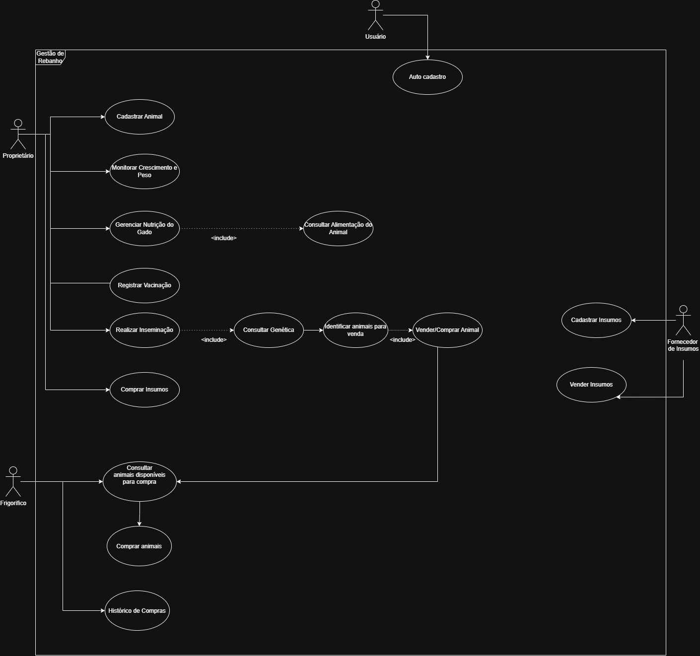
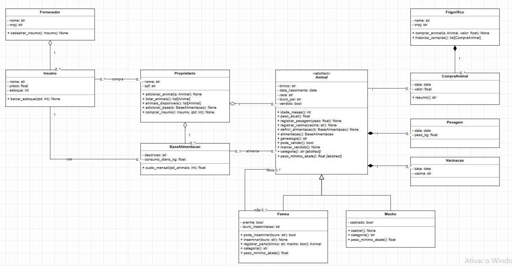

# Sistema de Gestão de Rebanho

Trabalho de POO I — tema **Gestão de Rebanho**. Sistema **multiusuário** para controlar o
rebanho de uma propriedade rural de gado de corte: cada usuário cria a sua conta (CPF e
senha) e cuida do rebanho dela — cadastro de animais, acompanhamento de peso e vacinas,
gestão de nutrição, inseminação e compra de insumos. Os dados de um usuário ficam isolados
dos dos outros.

**Autores:** Andrei Ruan Steffens, Estela Giovana Kaster, Paulo Henrique Vieira Klumb,
Matheus Zuchi Balbinot — Instituto Federal de Educação, Ciência e Tecnologia Catarinense,
Campus Concórdia.

## Diagramas UML

### Diagrama de casos de uso

Quatro atores (Proprietário, Frigorífico, Fornecedor de Insumos e Usuário), com os
`include` de Realizar Inseminação → Consultar Genética, Gerenciar Nutrição do Gado →
Consultar Alimentação do Animal e Identificar Animais para Venda → Vender/Comprar Animal.



### Diagrama de classes

As onze classes do sistema, com abstração, herança, agregação e composição:



Os arquivos também estão em `docs/` (`justificativa_teorica.pdf`), junto com os diagramas
em alta resolução.

## Justificativa Teórica da Modelagem

### 1. Introdução

O sistema serve para controlar o rebanho de uma propriedade rural. Ficamos só com gado de
corte. Com ele o proprietário cadastra os animais, acompanha peso, vacinas e alimentação,
compra insumos e vende os animais para o frigorífico.

### 2. Casos de Uso

O diagrama tem quatro atores. O **Proprietário** é quem mais usa o sistema: cadastra animais,
monitora crescimento e peso, gerencia a nutrição do gado, registra vacinação, realiza
inseminação e compra insumos. O **Frigorífico** consulta os animais disponíveis para compra,
compra os animais e vê o histórico de compras. O **Fornecedor de Insumos** cadastra e vende
insumos. O **Usuário** faz o autocadastro.

O cadastro aparece em Cadastrar Animal e Cadastrar Insumos, e a consulta em Consultar
Animais Disponíveis, Consultar Alimentação do Animal e Histórico de Compras. Usamos
`include` quando um caso de uso sempre precisa de outro para acontecer [1]. Realizar
Inseminação inclui Consultar Genética, porque antes de inseminar é preciso ver a genealogia
da fêmea. Gerenciar Nutrição do Gado inclui Consultar Alimentação do Animal. E Identificar
Animais para Venda tem um include com Vender/Comprar Animal, já que a identificação é feita
para chegar na venda. Não encontramos nenhum caso opcional que pedisse `extend`.

### 3. Diagrama de Classes

São onze classes: `Animal`, `Femea`, `Macho`, `Pesagem`, `Vacinacao`, `Proprietario`,
`BaseAlimentacao`, `Insumo`, `Fornecedor`, `Frigorifico` e `CompraAnimal`.

#### 3.1. Abstração e Herança

`Animal` é abstrata, porque no sistema todo animal é fêmea ou macho e não faz sentido criar
um animal sem saber qual dos dois ele é. Ela guarda o que é comum, como brinco, data de
nascimento, raça, pesagens e vacinas, e deixa `categoria()` e `peso_minimo_abate()` como
métodos abstratos. `Femea` e `Macho` herdam de `Animal`.

Separamos por sexo porque o manejo muda: só a fêmea tem `prenhe`, `inseminar()` e
`registrar_parto()`, e só o macho tem `castrado` e `castrar()`. Desse jeito não tem como
chamar `inseminar()` em um macho, porque o método não existe na classe dele.

#### 3.2. Encapsulamento

Todos os atributos são privados (`-`) e só mudam pelos métodos da própria classe [2].
Por exemplo, `vendido` só muda por `marcar_vendido()`, e `prenhe` só muda por `inseminar()`
ou `registrar_parto()`. O estoque de um insumo também não é alterado direto, só por
`baixar_estoque()`. Assim a validação fica em um lugar só e o resto do sistema não consegue
deixar um objeto em estado errado.

Daqui saem as duas regras de negócio do sistema. A primeira é que um animal só pode ser
vendido ao frigorífico quando `pode_vender()` permite, e depois da venda ele é marcado como
vendido para não ser vendido de novo. A segunda é que só fêmeas podem ser inseminadas, e
antes disso `pode_inseminar()` verifica se a inseminação com aquele touro é possível.

#### 3.3. Polimorfismo

`Femea` e `Macho` sobrescrevem `categoria()` e `peso_minimo_abate()`, então cada uma devolve
a sua categoria e o seu peso mínimo para abate. Como `pode_vender()` está em `Animal`, ela
pode chamar `peso_minimo_abate()` sem precisar saber se o objeto é fêmea ou macho.

#### 3.4. Agregação e Composição

Escolhemos pelo ciclo de vida das partes. `Pesagem` e `Vacinacao` são composição de
`Animal`, porque uma pesagem ou uma vacina registrada não existe sem o animal.
`CompraAnimal` é composição de `Frigorifico`, pois o registro faz parte do histórico daquele
frigorífico.

O `Proprietario` agrega os animais e as bases de alimentação, e o `Fornecedor` agrega os
insumos. Aqui a parte continua existindo sem o todo. O resto são associações: o proprietário
compra insumos, a base de alimentação usa um insumo, cada animal tem no máximo uma base de
alimentação, e cada `CompraAnimal` se refere a um animal. Também tem a associação entre
`Femea` e `Animal`, com os papéis de mãe e filhos, que é o que permite consultar a genética.

### 4. Considerações Finais

Deixamos as regras dentro das classes para que a interface em Tkinter só chame os métodos,
como pede o trabalho. Isso também deve facilitar os testes na segunda parte.

### Referências

1. VISUAL PARADIGM. _Include and Extend Use Case Diagram_. Disponível em:
   https://online.visual-paradigm.com/pt/diagrams/templates/use-case-diagram/include-and-extend-use-cases.
   Acesso em: 30 out. 2026.
2. LUCID SOFTWARE. _Tutorial de diagrama de classes UML_. Disponível em:
   https://lucid.co/pt/diagrama/uml/tutorial-de-diagrama-de-classes. Acesso em: 30 out. 2026.

## Arquitetura em camadas (influência do DDD e do Clean Code)

O código é organizado em camadas com dependências apontando para dentro, como no modelo
de arquitetura limpa: a camada de domínio não importa nada das outras camadas.

```
interfaces ──► usecases ──► domain ◄── infra
                             ▲
                   (infra implementa os contratos de repositório
                    que o resto do sistema consome)
```

- **`source/domain/`** — camada de domínio, o coração do sistema. Entidades (`Animal`,
  `Femea`, `Macho`, `Pesagem`, `Vacinacao`, `Insumo`, `BaseAlimentacao`, `Proprietario`,
  `Fornecedor`, `Frigorifico`, `CompraAnimal`), objetos de valor (`Brinco`, `Peso`,
  imutáveis e comparáveis por valor), exceções de negócio e os contratos de repositório
  (`repositorios.py`). As duas regras de negócio vivem aqui:
  `pode_vender()`/`marcar_vendido()` e `pode_inseminar()`/`inseminar()`; `baixar_estoque()`
  é exercitada de verdade na venda do fornecedor.
- **`source/usecases/`** — camada de aplicação: um caso de uso por classe, com nomes que
  espelham o diagrama de casos de uso (linguagem onipresente do DDD). Eles orquestram
  entidades e repositório, mas não contêm regra de negócio.
- **`source/infra/`** — a implementação concreta em JSON (`repositorio_json.py`), que cumpre
  os contratos definidos no domínio. O domínio não sabe que existe JSON.
- **`source/interfaces/`** — apresentação, organizada pelo papel da conta. A entrada é o
  login multiusuário (documento e senha, ou criação de conta já com o papel); montado o
  sistema com os dados da conta, a área do papel abre direto — sem seleção de perfil —,
  com uma janela (Tkinter) ou um submenu (console) só com as funções do papel. Sem
  regra de negócio: apenas chama casos de uso.

Princípios de Clean Code aplicados: responsabilidade única (um arquivo por responsabilidade),
inversão de dependência (casos de uso e interface dependem de abstrações, não da implementação
JSON), nomes reveladores de intenção e funções pequenas.

## Validação de estilo (flake8)

O projeto é verificado com o flake8. A configuração está no arquivo `.flake8` (limite de 100
caracteres por linha, aceito pelo PEP 8 para equipes). Para rodar:

```bash
python -m flake8 source testes main.py
```

Se o flake8 não estiver instalado: `pip install --user flake8`. O VS Code lê o arquivo
`.flake8` automaticamente, então o mesmo limite vale para os avisos do editor.

## Como executar

```bash
# Interface gráfica (Tkinter)
python main.py

# Menu de texto no terminal
python main.py --console

# Testes (unittest, biblioteca padrão)
python -m unittest discover -s testes -v
```

Ao abrir, o sistema pede o **login multiusuário**: entra-se com o documento e a senha da
conta, ou cria-se uma conta nova declarando o **papel** dela — Proprietário da fazenda
(CPF), Fornecedor de insumos (CNPJ) ou Frigorífico (CNPJ). O papel acompanha a conta: o
login abre direto a área correspondente, sem perguntar "quem está usando", e o cadastro
do papel nasce semeado no arquivo da conta. Cada conta tem um arquivo de dados próprio;
ao encerrar a sessão, o fluxo volta ao login, para que outro usuário entre com a conta
dele.

## Estrutura do projeto

```
Gestao_Rebanho/
├── README.md
├── main.py                     # composição de raiz (wiring) + entrada do sistema
├── docs/
│   ├── diagrama_classes.jpeg   # diagrama de classes UML
│   ├── diagrama_casos_de_uso.jpeg
│   └── justificativa_teorica.pdf
├── testes/
│   ├── test_entidades.py       # regras de negócio do domínio
│   ├── test_casos_de_uso.py    # casos de uso com repositórios em memória
│   ├── test_contas.py          # multiusuário: contas, índice e migração
│   └── test_repositorios.py    # persistência em JSON
└── source/
    ├── domain/
    │   ├── entidades/
    │   │   ├── animal.py       # Animal (abstrata), Femea, Macho
    │   │   ├── manejo.py       # Pesagem, Vacinacao (composição de Animal)
    │   │   ├── insumo.py       # Insumo, BaseAlimentacao
    │   │   ├── conta.py        # Conta de acesso e normalizar_cpf (multiusuário)
    │   │   └── pessoas.py      # Proprietario, Fornecedor, Frigorifico, CompraAnimal
    │   ├── objetos_valor.py    # Brinco, Peso (imutáveis, por valor)
    │   ├── repositorios.py     # contratos de repositório (interfaces abstratas)
    │   └── excecoes.py         # exceções de negócio
    ├── usecases/
    │   ├── casos_de_uso.py     # um caso de uso por classe
    │   ├── senhas.py           # credencial de acesso: hash PBKDF2 com salt
    │   └── contenedor.py       # contêiner dos casos de uso
    ├── infra/
    │   └── repositorio_json.py # implementação em JSON (dados.json e usuarios.json)
    └── interfaces/
        ├── interface_tkinter.py  # entrada gráfica: login → área do papel da conta
        ├── janela_login.py       # login multiusuário e criação de conta (com papel)
        ├── janela_autocadastro.py # autocadastro do Usuário (nome, CPF e senha)
        ├── janela_proprietario.py # área do Proprietário
        ├── janela_frigorifico.py  # área do Frigorífico
        ├── janela_fornecedor.py   # área do Fornecedor de Insumos
        ├── formularios.py         # formulários Label + Entry compartilhados
        └── presenter_console.py   # login em texto + menu por ator, com credencial
```

## Pilares de POO aplicados

- **Abstração e herança**: `Animal` é abstrata (`abc.ABC` + `@abstractmethod`), porque no
  sistema todo animal é fêmea ou macho. `Femea` e `Macho` herdam e sobrescrevem
  `categoria()` e `peso_minimo_abate()`.
- **Encapsulamento**: todos os atributos são privados (`__`) e só mudam pelos métodos da
  própria classe; leitura externa passa por `@property`.
- **Polimorfismo**: `pode_vender()` usa `peso_minimo_abate()` abstrato, e cada subclasse
  responde à sua própria maneira.
- **Agregação e composição**: `Pesagem` e `Vacinacao` são composição de `Animal`;
  `CompraAnimal` é composição de `Frigorifico`; `Proprietario` agrega animais e bases de
  alimentação; `Fornecedor` agrega insumos.

## Regras de negócio

1. **Venda ao frigorífico**: um animal só pode ser vendido quando `pode_vender()` permite
   (peso atual ≥ peso mínimo de abate da categoria) e, depois da venda, é marcado como
   vendido para não ser vendido de novo.
2. **Inseminação**: só fêmeas podem ser inseminadas e `pode_inseminar()` verifica a
   genealogia (o touro não pode ser o próprio animal, nem o pai, nem um filho dela).
3. **Estoque**: `baixar_estoque()` garante que o estoque de um insumo nunca fica negativo —
   é ela quem valida a venda do fornecedor antes da mercadoria chegar à fazenda.
4. **Parto**: só fêmea prenhe tem parto; `registrar_parto(brinco_filho, macho)` cria o
   bezerro já vinculado à genealogia (mãe e touro da inseminação) e o devolve.

## Dos diagramas ao código

Cada bolha do diagrama de casos de uso é uma classe em `source/usecases/casos_de_uso.py`:

| Caso de uso (ator)                                      | Classe                                       |
| ------------------------------------------------------- | -------------------------------------------- |
| Cadastrar Animal (Proprietário)                         | `CadastrarAnimal`                            |
| Monitorar Crescimento e Peso                            | `RegistrarPesagem` (+ listagens)             |
| Registrar Vacinação                                     | `RegistrarVacinacao`                         |
| Consultar Genética (include)                            | `ConsultarGenetica`                          |
| Realizar Inseminação                                    | `InseminarFemea`                             |
| Registrar parto (fluxo da inseminação)                  | `RegistrarParto`                             |
| Gerenciar Nutrição do Gado                              | `CriarBaseAlimentacao`, `DefinirAlimentacao` |
| Consultar Alimentação do Animal (include)               | `ConsultarAlimentacao`                       |
| Identificar Animais para Venda                          | `IdentificarAnimaisParaVenda`                |
| Vender/Comprar Animal                                   | `VenderAnimal`                               |
| Comprar Insumos (Proprietário)                          | `ComprarInsumo`                              |
| Cadastrar Insumos (Fornecedor)                          | `CadastrarInsumo`                            |
| Vender Insumos (Fornecedor)                             | `VenderInsumo`                               |
| Consultar Animais Disponíveis para Compra (Frigorífico) | `IdentificarAnimaisParaVenda`                |
| Histórico de Compras (Frigorífico)                      | `HistoricoCompras`                           |
| Auto cadastro (Usuário)                                 | `Autocadastro`                               |

### Extensões deliberadas sobre o diagrama

O código segue o desenho entregue; alguns recursos internos vão além dele, sem
contrariá-lo:

- **Objetos de valor** `Brinco` e `Peso` (imutáveis, comparáveis por valor) e a
  hierarquia `RegraNegocioViolation` de exceções de negócio.
- **`estoque` como float** em `Insumo` (o diagrama traz `int`; ração e sal são fracionados).
- **`pai_brinco`** na genealogia (o diagrama modela só a associação mãe–filhos) e o
  contador de `partos` em `Femea`.
- **Métodos `restaurar_*`** nas entidades: reconstroem o estado salvo pelo repositório
  sem passar pelas regras de negócio.
- **Parâmetros opcionais de data** em pesagem, vacinação e compra (o diagrama registra só
  o essencial; a data padrão é hoje).
- **Um único estoque de insumo no comércio**: `ComprarInsumo` e `VenderInsumo` são as duas
  vistas (proprietário/fornecedor) da mesma transação, como no diagrama, sem duplicar lotes.
- **Entrada por perfil com credencial**: cada conta de acesso declara o papel do ator
  que ela representa e entra pelo documento do cadastro — o proprietário com CPF **e
  senha**, o fornecedor e o frigorífico com CNPJ — com o cadastro do papel semeado no
  arquivo da conta quando ela nasce. O `Autocadastro` do diagrama é o cadastro do
  Usuário (proprietário); fornecedor e frigorífico ganham o cadastro equivalente no
  ato da criação da conta e podem corrigi-lo na própria área.
- **Multiusuário**: cada usuário do sistema tem a própria conta (`Conta`), criada pelo
  autocadastro multiusuário (`CadastrarConta`) e autenticada no login
  (`AutenticarConta`) por documento (CPF ou CNPJ) e senha — o documento é reduzido aos
  dígitos (`normalizar_documento`), então pontuação é só apresentação. O índice de
  contas (`usuarios.json`, `IndiceContasJson`) guarda nome, documento, papel, credencial
  da senha e o arquivo de dados de cada um. Contas nascem isoladas: o trabalho de cada
  papel fica no arquivo da conta (`dados_<documento>.json`) e um usuário nunca enxerga
  os dados do outro. Ao corrigir o próprio cadastro (`Autocadastro` e os cadastros de
  fornecedor/frigorífico), o índice de contas é atualizado junto, para que a próxima
  entrada continue encontrando o usuário; já existe conta com o mesmo documento?
  `DocumentoDuplicadoError`.
- **Senha com hash**: a senha do autocadastro nunca é guardada em texto plano —
  `usecases/senhas.py` gera um hash PBKDF2 com salt aleatório (formato
  `pbkdf2$iterações$salt$hash`), conferido em tempo constante no login. O domínio
  enxerga só uma credencial opaca.
- **Venda de animal em duas vistas**: `VenderAnimal` atende ao Proprietário
  ("Vender ao frigorífico") e ao Frigorífico ("Comprar animal") — a mesma transação
  vista pelos dois atores, como já acontecia com os insumos.
- **Migração do cadastro-padrão**: arquivos antigos com o proprietário padrão
  ("Fazenda Boa Esperança", CPF zerado) são tratados como sem cadastro, para passarem
  pelo autocadastro obrigatório do primeiro acesso.

## Persistência

Sistema multiusuário: cada conta tem o **seu próprio arquivo de dados**
(`dados_<documento>.json`, criado — já com o cadastro do papel semeado — quando a
conta nasce), com oito seções: `animais`
(pesagens, vacinas, genealogia, estado reprodutivo, base de alimentação e venda),
`insumos` (estoque da fazenda), `fornecedor` (catálogo de lotes do fornecedor),
`fornecedor_cadastro` (cadastro do fornecedor: nome e CNPJ), `bases` (bases de
alimentação), `compras` (histórico do frigorífico), `frigorifico` (cadastro do
frigorífico: nome e CNPJ) e `proprietario` (autocadastro: nome, CPF e hash da senha).
Cada conta usa as seções do papel dela: a do fornecedor guarda o catálogo e o cadastro
dele, a do frigorífico guarda o cadastro e as compras, a do proprietário guarda o
rebanho, o estoque, as bases e os cadastros dos parceiros com quem comercializa.
O índice de contas fica em `usuarios.json` (seção `contas`: nome, documento, papel,
credencial da senha — só o hash — e arquivo de dados de cada usuário).

Tudo sobrevive entre execuções — inclusive o histórico de compras do frigorífico.
Arquivos antigos, com as chaves de insumo anteriores (`preco_unitario`/`quantidade`),
continuam sendo lidos; o cadastro-padrão antigo do proprietário é tratado como sem
cadastro, e cadastros antigos sem senha voltam ao autocadastro do primeiro acesso.

**Migração do sistema de um usuário só**: na primeira execução multiusuário, se ainda
não existe `usuarios.json` mas há um cadastro válido em `dados.json`, esse cadastro se
torna a primeira conta do índice — papel Proprietário, com a credencial que já estava
no arquivo — e a conta continua apontando para o mesmo `dados.json`: nada é perdido nem
renomeado. Contas criadas de então em diante ganham arquivo próprio.
